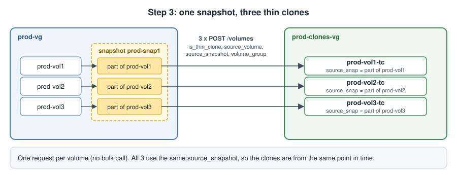
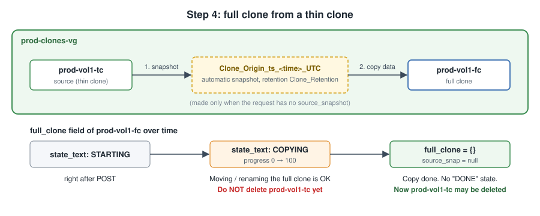
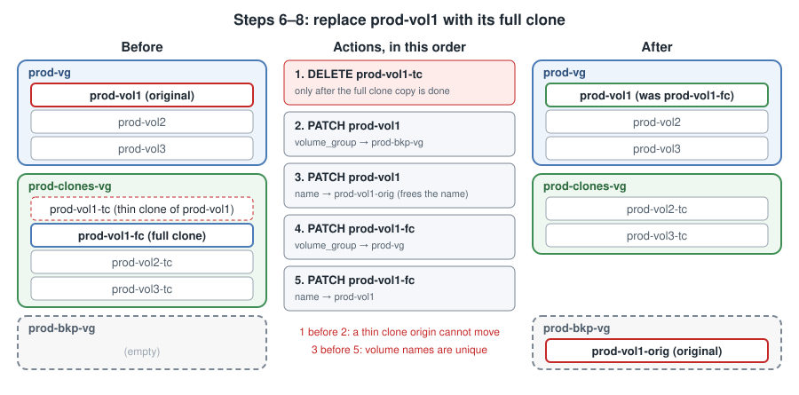
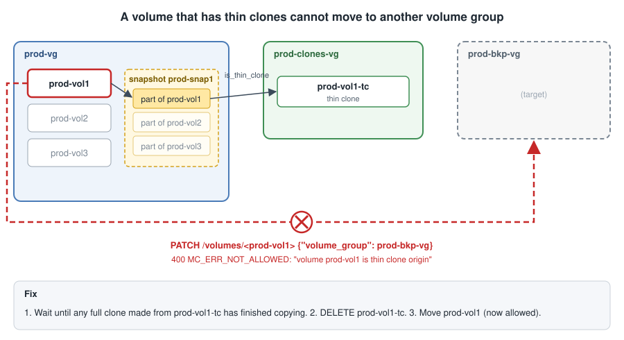

# SDP REST API usage examples (curl): snapshot, thin clone, full clone, volume swap

Target: Silk SDP 9.5.20.x REST API (`/api/v2`).

The full REST API reference is the *Silk RESTful API Guide*:
<https://support.silk.us/sys/document/preview/Draft-v8595-Silk-RESTful-API-Guide-250625025250263.pdf>

> **Important: volume names and volume group names must be unique in the whole SDP.**
> Two volumes cannot have the same name, even in different volume groups.
> Two volume groups cannot have the same name.
> A duplicate name returns `MC_ERR_ALREADY_EXIST`.
> To reuse a name, rename the object that has it first.

## The scenario

A production volume group has 3 volumes. We:

1. Snapshot the production volume group.
2. Create a new volume group for clones.
3. Create 3 thin clones (one per volume) from that snapshot, in the new group.
4. Create a full clone from thin clone 1, and wait until it is fully copied.
5. Create a backup volume group.
6. Move the original volume 1 to the backup group (and give it a new name).
7. Move the full clone into the production group, in place of volume 1.
8. Rename the full clone to the original volume 1 name.

Names (the prefix shows what belongs to what):

| Object | Name |
|---|---|
| Production volume group | `prod-vg` |
| Production volumes | `prod-vol1`, `prod-vol2`, `prod-vol3` |
| Snapshot of `prod-vg` | `prod-snap1` (full name `prod-vg:prod-snap1`) |
| Clone volume group | `prod-clones-vg` |
| Thin clones | `prod-vol1-tc`, `prod-vol2-tc`, `prod-vol3-tc` |
| Full clone of `prod-vol1-tc` | `prod-vol1-fc`, renamed to `prod-vol1` at the end |
| Backup volume group | `prod-bkp-vg` |
| Original volume 1 after the swap | `prod-vol1-orig` |

## Rules to know first

- All sizes are in **KB** (1 GiB = 1048576 KB).
- A reference to another object is written as `{"ref": "/<collection>/<id>"}`.
- **Volume names and volume group names are unique in the whole SDP.**
  Volume names are unique across all volume groups, not only inside one.
  To reuse a name, rename the object that has it first.
- **A volume that is a thin clone origin cannot move to another volume group.**
  The SDP returns `MC_ERR_NOT_ALLOWED ... is thin clone origin`.
  Delete its thin clones first.
- A **full clone copies data in the background.** While it copies,
  `full_clone.state_text` is `STARTING`, then `COPYING`. When the copy is done,
  `full_clone` becomes `{}` and `source_snap` becomes `null`.
  Do not delete the clone source while the copy runs.
- There is **no bulk call for clones**. Create one clone per request.
- Rate limit: 20 requests/s (burst 100). Above that the SDP returns `429`.

## Connect

The API is HTTPS only. Choose one way to log in.

**Directly on the SDP** (HTTP Basic Auth, SDP user and password):

```bash
BASE="https://10.0.0.10/api/v2"            # SDP management IP
AUTH=(-u 'admin:password')
```

**Through Flex** (Bearer app token created by a Flex admin):

```bash
BASE="https://10.0.0.5/rest/sdps/<sdp-id>/api/v2"   # Flex IP and SDP ID
AUTH=(-H "Authorization: Bearer <app token>")
```

`<sdp-id>` is the SDP system ID, for example `d91e01`. It is the `system_id` field of
`GET /api/v2/system/state`.

Helpers used in all steps (`jq` is needed to read IDs from the answers):

```bash
api() { curl -k -s "${AUTH[@]}" -H 'Content-Type: application/json' "$@"; }
id_of() { api "$BASE/$1?name=$2&__fields=id" | jq -r '.hits[0].id'; }   # id_of <collection> <name>
```

`-k` skips the TLS certificate check. Remove it if the SDP has a trusted certificate.

Check the login. The API root lists all resources; a wrong login returns `401`:

```bash
api "$BASE/" | jq '.resources | keys | length'
```

## 0. Starting point: `prod-vg` with 3 volumes

Skip this step if the group already exists.

```bash
api -X POST "$BASE/volume_groups" -d '{"name": "prod-vg", "quota": 104857600}'   # 100 GiB
PROD_VG=$(id_of volume_groups prod-vg)

for i in 1 2 3; do
  api -X POST "$BASE/volumes" -d "{
    \"name\": \"prod-vol$i\",
    \"size\": 10485760,
    \"volume_group\": {\"ref\": \"/volume_groups/$PROD_VG\"}
  }"                                                                            # 10 GiB each
done
```

## 1. Snapshot the production volume group

`short_name` is the snapshot's own name. The SDP shows it as `prod-vg:prod-snap1`.

```bash
PROD_VG=$(id_of volume_groups prod-vg)
POLICY=$(id_of retention_policies Best_Effort_Retention)

SNAP=$(api -X POST "$BASE/snapshots" -d "{
  \"short_name\": \"prod-snap1\",
  \"source\": {\"ref\": \"/volume_groups/$PROD_VG\"},
  \"retention_policy\": {\"ref\": \"/retention_policies/$POLICY\"}
}" | jq -r .id)
```

Answer (shortened):

```json
{"id": 86, "name": "prod-vg:prod-snap1", "short_name": "prod-snap1",
 "source": {"ref": "/volume_groups/82"}, "retention_policy": {"ref": "/retention_policies/4"}}
```

## 2. Create the clone volume group

```bash
CLONES_VG=$(api -X POST "$BASE/volume_groups" -d '{
  "name": "prod-clones-vg",
  "quota": 104857600
}' | jq -r .id)
```

## 3. Create 3 thin clones from the snapshot

One request per volume. All clones come from the same snapshot, so they are
consistent with each other (same point in time).



```bash
for i in 1 2 3; do
  VOL=$(id_of volumes prod-vol$i)
  api -X POST "$BASE/volumes" -d "{
    \"is_thin_clone\": true,
    \"name\": \"prod-vol$i-tc\",
    \"source_volume\":   {\"ref\": \"/volumes/$VOL\"},
    \"source_snapshot\": {\"ref\": \"/snapshots/$SNAP\"},
    \"volume_group\":    {\"ref\": \"/volume_groups/$CLONES_VG\"}
  }"
done
```

Answer for one clone (shortened). `source_snap` points to this volume's part of the
snapshot:

```json
{"id": 91, "name": "prod-vol1-tc", "description": "Clone of volume prod-vol1",
 "size": 10485760, "source_snap": {"ref": "/volsnaps/87"},
 "volume_group": {"ref": "/volume_groups/90"}}
```

> **Note.** Use `source_snapshot`. The thin clone example in the 9.5.20 guide shows
> `"snapshot_name": "vg:snap"`. The SDP does not read that field.

## 4. Create a full clone from thin clone 1



```bash
TC1=$(id_of volumes prod-vol1-tc)

FC=$(api -X POST "$BASE/volumes" -d "{
  \"is_full_clone\": true,
  \"name\": \"prod-vol1-fc\",
  \"source_volume\": {\"ref\": \"/volumes/$TC1\"},
  \"volume_group\":  {\"ref\": \"/volume_groups/$CLONES_VG\"}
}" | jq -r .id)
```

Here no `source_snapshot` is given. The SDP then takes a new snapshot of the source
(`prod-clones-vg:Clone_Origin_ts_<time>_UTC`, retention `Clone_Retention`) and copies
from it. To copy from an existing snapshot, add `"source_snapshot": {"ref": "/snapshots/<id>"}`.

Answer (shortened):

```json
{"id": 98, "name": "prod-vol1-fc", "description": "Clone of volume prod-vol1-tc",
 "full_clone": {"progress": 0, "state_text": "STARTING", "stop_reason_text": "NONE"},
 "source_snap": {"ref": "/volsnaps/95"}}
```

Wait until the copy is done:

```bash
while :; do
  S=$(api "$BASE/volumes/$FC?__fields=full_clone,source_snap")
  echo "$S" | jq -c .full_clone
  [ "$(echo "$S" | jq -c .full_clone)" = "{}" ] && break      # copy done
  sleep 10
done
```

Output during and after the copy:

```
{"progress":38,"state_text":"COPYING","stop_reason_text":"NONE"}
...
{}
```

## 5. Create the backup volume group

```bash
BKP_VG=$(api -X POST "$BASE/volume_groups" -d '{
  "name": "prod-bkp-vg",
  "quota": 104857600
}' | jq -r .id)
```

## Steps 6–8 at a glance

Steps 6–8 replace `prod-vol1` with its full clone. The order of the actions matters.



## 6. Move the original volume 1 to the backup group

> **Important: a volume that has thin clones cannot move to another volume group.**
> The SDP returns `MC_ERR_NOT_ALLOWED ... is thin clone origin`.
> Delete its thin clones first. Renaming such a volume is allowed.



`prod-vol1` is the origin of thin clone `prod-vol1-tc`, so it cannot move yet.
After the full clone copy is done (step 4), delete that thin clone:

```bash
api -X DELETE "$BASE/volumes/$TC1"          # prod-vol1-tc
```

Then move the original volume and give it a new name. The new name frees
`prod-vol1` for the full clone.

```bash
VOL1=$(id_of volumes prod-vol1)
api -X PATCH "$BASE/volumes/$VOL1" -d "{\"volume_group\": {\"ref\": \"/volume_groups/$BKP_VG\"}}"
api -X PATCH "$BASE/volumes/$VOL1" -d '{"name": "prod-vol1-orig"}'
```

Without the delete, the move fails:

```
400 {'key': 'MC_ERR_NOT_ALLOWED',
     'info': "Operation is not allowed on 'volume prod-vol1 is thin clone origin'"}
```

## 7. Move the full clone into the production group

```bash
api -X PATCH "$BASE/volumes/$FC" -d "{\"volume_group\": {\"ref\": \"/volume_groups/$PROD_VG\"}}"
```

## 8. Rename the full clone to the original name

```bash
api -X PATCH "$BASE/volumes/$FC" -d '{"name": "prod-vol1"}'
```

If the old volume still has that name, the rename fails:

```
400 {'key': 'MC_ERR_ALREADY_EXIST', 'info': "operation failed: 'prod-vol1' already exists"}
```

Check the result:

```bash
api "$BASE/volumes?name__prefix=prod-vol&__fields=name,volume_group,source_snap&__sort=name" | jq -c '.hits[]'
```

```
{"name":"prod-vol1","source_snap":null,"volume_group":{"ref":"/volume_groups/82"}}       <- the full clone
{"name":"prod-vol1-orig","source_snap":null,"volume_group":{"ref":"/volume_groups/99"}}  <- original, in prod-bkp-vg
{"name":"prod-vol2","source_snap":null,"volume_group":{"ref":"/volume_groups/82"}}
{"name":"prod-vol2-tc","source_snap":{"ref":"/volsnaps/88"},"volume_group":{"ref":"/volume_groups/90"}}
{"name":"prod-vol3","source_snap":null,"volume_group":{"ref":"/volume_groups/82"}}
{"name":"prod-vol3-tc","source_snap":{"ref":"/volsnaps/89"},"volume_group":{"ref":"/volume_groups/90"}}
```

## Clean up

Order matters: clones first, then snapshots, then volumes, then volume groups.

```bash
for n in prod-vol2-tc prod-vol3-tc; do api -X DELETE "$BASE/volumes/$(id_of volumes $n)"; done
api -X DELETE "$BASE/snapshots/$SNAP"
for n in prod-vol1 prod-vol2 prod-vol3 prod-vol1-orig; do api -X DELETE "$BASE/volumes/$(id_of volumes $n)"; done
for n in prod-clones-vg prod-bkp-vg prod-vg; do api -X DELETE "$BASE/volume_groups/$(id_of volume_groups $n)"; done
```

The automatic `Clone_Origin_ts_...` snapshot from step 4 did not need a manual
delete. It was gone after its source thin clone was deleted.

## Other useful calls

Read the thin clone depth limit of the system:

```bash
api "$BASE/system/partial_system_parameters?__fields=thin_clone_max_depth"
```
